<div align="center">



<a href="https://www.linkedin.com/in/mohamed-aziz-chagour"></a>
<a href="https://x.com/chagourmedaziz"></a>
<a href="https://github.com/MedAziz11/Uptime-Kuma-Web-API"></a>

</div>

```console
$ whoami
mohamed-aziz-chagour

$ cat /etc/role
DevOps & Cloud Platform Engineer / SRE @ NeoXam
Production Kubernetes (Amazon EKS), AWS, and the CI, GitOps and observability tooling around it.

$ ls certs/
CKA.pem   AWS-Solutions-Architect-Associate.pem   CKAD.pem.part
```

## `> featured_project`

### [Uptime-Kuma-Web-API](https://github.com/MedAziz11/Uptime-Kuma-Web-API)

A REST API for [Uptime Kuma](https://github.com/louislam/uptime-kuma): manage monitors, status
pages, maintenances, tags and notifications over HTTP, with Swagger docs and a Docker image.

[](https://github.com/MedAziz11/Uptime-Kuma-Web-API/releases/latest)
[](https://hub.docker.com/r/medaziz11/uptimekuma_restapi)
[](https://github.com/MedAziz11/Uptime-Kuma-Web-API/actions/workflows/ci.yml)
[](https://github.com/MedAziz11/Uptime-Kuma-Web-API/blob/main/LICENSE)

```console
$ docker pull medaziz11/uptimekuma_restapi:latest
```

## `> tail -n 5 mission.log`

```console
[OK]  cloud-migration   CI and regression-test platform moved from VMware to AWS (Terraform, Ansible); campaigns 82% faster
[OK]  kubernetes        EKS clusters operated and scaled; Helm + ArgoCD delivery; Cilium chained with the AWS VPC CNI
[OK]  observability     OpenTelemetry, VictoriaMetrics, Loki, Tempo, Grafana; SLIs/SLOs; traced Ansible runs; Go exporters
[OK]  self-healing      Grafana alerts trigger remediation playbooks; MTTR down by up to 60%
[OK]  ai-agents         company-wide agentic AI platform (FastAPI, MCP, RAG, Bedrock); 1st place, NeoXam Innovation Prize
```

## `> kubectl get skills`

<div align="center">


</div>

```console
NAMESPACE        TOOLS                                                              STATUS
languages        Python (FastAPI) · Go · Bash                                       Running
cloud            AWS · EKS · Helm · Docker · Karpenter · Cilium (eBPF)              Running
iac-gitops       Terraform · Terramate · Ansible · ArgoCD                           Running
ci-cd            GitHub Actions · Jenkins                                           Running
observability    OpenTelemetry · VictoriaMetrics · Prometheus · Grafana · Loki      Running
security         HashiCorp Vault · External Secrets Operator · Gitleaks             Running
ai-agents        MCP servers · LangChain · RAG · Langfuse                           Running
```

## `> ps aux | grep now`

```console
maintaining   Uptime-Kuma-Web-API 2.x
learning      eBPF, deeper down the stack
preparing     CKAD
ask-me        EKS · Cilium · GitOps · observability
```

<div align="center">



</div>
